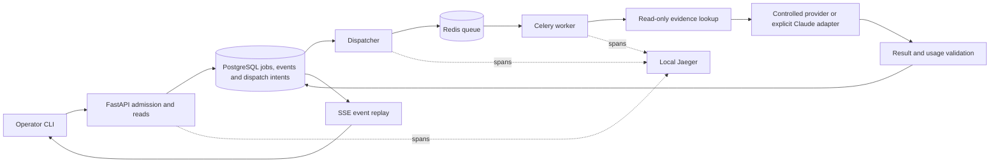
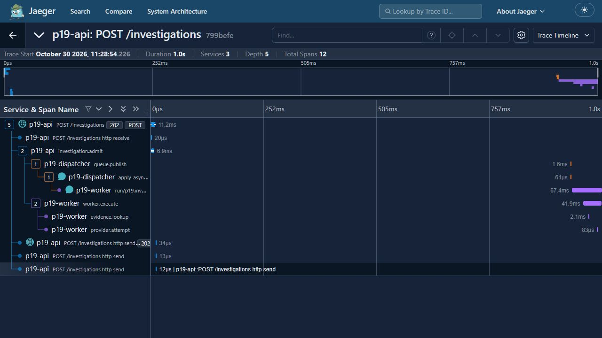

# Observable Python AI service

A synthetic sales-export investigation service built with **Python, FastAPI,
PostgreSQL, Redis/Celery and OpenTelemetry**. An operator submits a failed export,
follows persisted progress over SSE and receives a structured explanation informed by
retrieved receiver facts. The service never resends a sale or changes accounting data.

The engineering focus is asynchronous job operation: idempotent admission, durable
dispatch intent, cancellation, bounded calls, conservative crash recovery and tracing.
The default provider is deterministic and needs no external API key. This is a bounded
personal CV demonstration, not a production deployment or evidence of customer adoption.

## Evidence at a glance

Measured 30 October 2026. Results below have different sources and sample sizes.

| Evidence | Observed result | Scope and source |
|---|---|---|
| Latest integrated offline checks | **134 tests passed**, plus lock/lint/format | Controlled providers and transport stubs; PostgreSQL, Redis, real HTTP/SSE, Celery and Docker lifecycle checks. [Integration evidence](docs/evidence/context-followup-integration.json). |
| Original controlled load sample | 24 submissions at concurrency 4; 8 admitted/succeeded and 16 rejected by admission control | Historical implementation, maximum 8 active jobs and 1 provider call. Not rerun on the latest source and not a production capacity claim. [Local report](docs/local-report.md). |
| Original Haiku sample | 1 pass, 1 semantic failure, 1 unrun after 2 inferences | Stopped when a receipt case returned unresolved. [Original live report](docs/live-report.md). |
| Fresh context follow-up | 0 passes, 1 failed citation criterion, 2 unrun after 1 inference | Correct rejection outcome but missing the required evidence ID; stopped immediately. [Follow-up report](docs/context-followup-report.md). |

Across the two stopped provider studies: **3 inferences**, 2,219 input/691 output tokens
and **USD0.0005674 known API-usage estimate before tax/FX**, with no unresolved reservation
under one cumulative USD2 ceiling. This is not settled billing or a general accuracy
result. Both studies remain stopped; unspent allowance does not authorize continuation.

An offline repair added persisted export/sale IDs to the model input and rejects missing
or foreign bindings. The follow-up stopped before reaching its receipt case, so the
repair's effect on that model response remains unproven. [Repair evidence](docs/receipt-context-repair.md).
Hosted GitHub CI and public publication are pending review; the prepared workflow is
offline only.

## Workflow and architecture



PostgreSQL owns job state, attempts, progress and accounting. The dispatcher publishes
committed intents; duplicate delivery does not create another provider call. Lookup is
application-driven and matches both export and sale identity. The model does not select
tools or perform remediation.

- The same idempotency key and body returns the original job; a changed body conflicts.
- SSE replays committed events. Disconnecting does not cancel work, and progress is not
  model-token streaming or a fabricated percentage.
- Cancellation before dispatch prevents a call. After dispatch it preserves the request,
  usage and uncertainty; it does not prove that processing or billing stopped.
- A stopped worker before dispatch leaves interrupted work. After committed dispatch
  intent, recovery preserves an unknown outcome and never automatically calls again.
- Only an explicitly confirmed non-executed **controlled** 429 can retry, once. Live
  calls have no automatic retry, warming or fallback.
- The general service validates structure, supported evidence IDs and receiver outcome.
  The study driver additionally requires the case's exact citation. That stricter gate
  failed the fresh sample even though its general service job mechanically succeeded.

One collected [follow-up trace](docs/evidence/context-followup-failure-trace.json) has
12 spans across API, dispatcher and worker. The earlier captured viewer below belongs
to the original controlled demonstration, not the later model samples.



## Run the controlled demo

Use Docker with Linux containers and Compose, from a fresh checkout. On Windows, keep
one Ubuntu WSL terminal open; on this development machine, ending the last foreground
session could stop the distro and containers.

```sh
python3 scripts/setup.py
docker compose -p p19-demo up -d --build api dispatcher worker jaeger
docker compose -p p19-demo run --rm tools python scripts/demo.py
```

Setup creates ignored local credentials without printing their values. The API binds
`127.0.0.1:8199` and Jaeger binds `127.0.0.1:16699`; database, Redis and OTLP ports remain
inside the project network. Change a loopback binding if another service owns its port.
Investigation operations require the generated bearer token, inherited by tools. Setup
does not provision an external provider key or paid allowance.

Through `tools`, the CLI supports `p19 submit --file FILE --idempotency-key KEY`,
`p19 get JOB`, `p19 follow JOB --after EVENT_ID` and `p19 cancel JOB`. The three fixtures
cover explicit rejection, receipt despite a timeout, and unresolved receiver outcome.

## Run offline checks

```sh
docker compose -p p19-check run --rm --build checks python scripts/verify.py
```

Run database-dependent tests serially. The check project has separate names and volumes.
Its canonical verifier checks the lock file, Ruff lint/format and pytest, retaining
source-bound receipts under ignored `.local/runs/`. Missing Docker services fail
verification rather than silently skipping integration tests.

The [prepared GitHub workflow](.github/workflows/offline.yml) uses the same verifier on
an Ubuntu hosted runner, generated local-only credentials and controlled providers.
It receives no provider key and records receipts/test totals in job logs and the run
summary, with no artifact upload. A passing
hosted run will be reported only after it actually exists.

Checks and lifecycle tooling use the local Docker socket to control exact owned
containers; API, dispatcher and worker do not receive it. Use this on a trusted local
machine. Recovery verifies stopped state, labels, instance identity, network and allowed
mounts before creating an owned replacement. This is a controlled local restart protocol,
not automatic failover under network partitions.

## Code and evidence map

| Area | Implementation |
|---|---|
| Admission, reads and SSE | [API](src/p19/api.py), [job store](src/p19/jobs.py), [stream](src/p19/stream.py) |
| Dispatch, execution and recovery | [Dispatcher](src/p19/dispatcher.py), [runner](src/p19/runner.py), [attempts](src/p19/attempts.py), [lifecycle guard](src/p19/lifecycle.py) |
| Evidence and provider boundary | [Lookup](src/p19/evidence.py), [contracts](src/p19/contracts.py), [Claude adapter](src/p19/claude.py) |
| Persistent study and cumulative allowance | [Study guard](src/p19/live.py), [history reconciliation](src/p19/live_history.py), [schema](src/p19/schema.sql) |
| Trace collection and measurements | [Telemetry](src/p19/telemetry.py), [reporting](src/p19/reporting.py) |
| Scope, failures and measured outcomes | [Local report](docs/local-report.md), [original live report](docs/live-report.md), [follow-up report](docs/context-followup-report.md) |
| CV and interview presentation | [Portfolio notes](docs/portfolio.md) |

## Boundaries and cleanup

The supported local limits are 8 active admitted jobs and 1 worker process/provider call.
Lookup/provider/job bounds are 2/10/30 seconds. Queue wait is bounded at 60 seconds and
publication reservations at three attempts, five seconds apart. These are selected demo
constraints, not availability or throughput guarantees.

The [live runbook](docs/context-followup-runbook.md) records the historical procedure.
Fresh clones lack its private original-history proof; this README does not authorize
another paid sample. Raw receipts, credentials and the actual provider key stay ignored.
Safe dated aggregates and synthetic traces are committed. Jaeger storage is in memory,
so export needed traces before stopping it.

Four diagnostic/test limitations remain deferred: cross-study race coverage, early
retired-run rejection in the direct preparation helper, partial CLI output retention
after timeout/nonzero exit, and explicit follow-up/recovery trace links. Their effects
and the two unsuccessful samples are recorded in the follow-up report. Human-validated
quality, receipt-context improvement, general model accuracy and commercial adoption
remain unproven.

```sh
docker compose -p p19-demo stop
docker compose -p p19-check stop
```

These commands retain history volumes. Keep cleanup scoped to owned project resources.
There is no cloud deployment in this project.
